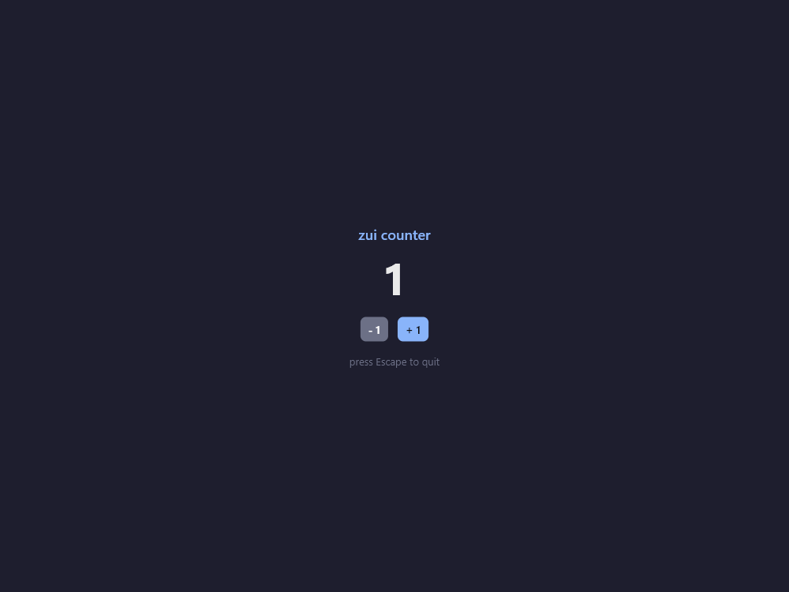

# zui

A declarative, Skia-based UI library for [Zig](https://ziglang.org), written in
the spirit of [Freya](https://github.com/marc2332/freya).

Freya's Rust stack maps onto zui roughly like this:

| Freya            | zui                                   |
|------------------|---------------------------------------|
| dioxus (VDOM)    | `element` + `reconcile`               |
| hooks / signals  | `context.Context` (`useState`, ...)   |
| Skia             | `skia` (Zig bindings over `zsk`, a C ABI on Skia) |
| taffy (flexbox)  | `layout`                              |
| winit            | `window` (GLFW 3.4, compiled from source) |
| the renderer     | `paint`                               |
| the event loop   | `app`                                 |

Windows only for now (the Skia binaries are built for the MSVC ABI and the
window layer uses the Win32/GLFW backend).



The counter example, captured by `zig build check`: it drives the UI
programmatically (hover, click, live resize), reads the framebuffer back and
writes `screenshot.png`.

## Building blocks

```
src/
  zsk.h / zsk.cpp        thin C ABI over the parts of Skia that zui uses,
                         compiled with MSVC's cl.exe (Skia is C++ and its
                         prebuilt libraries use the MSVC ABI and the dynamic
                         runtime, so it cannot be compiled by Zig's clang)
  zui/
    zui.zig              library root; `zui.launch(Root, props)` entry point
    element.zig          the virtual DOM: `Element` (rect/text/image/shape/
                         component/none), `Style` (flexbox subset + text +
                         paint + scroll), handlers
    context.zig          `Context`: React-style hooks (`useState`, `useSignal`,
                         `useMemo`), component constructors, `State(T)`
    signal.zig           `Signal(T)` reactive value
    node.zig             retained tree: hooks, cached Skia paragraphs/images/
                         paths, scroll state, layout box
    reconcile.zig        diffing (kind + key matching) of the fresh element tree
                         against the retained node tree
    layout/layout.zig    flexbox: column/row, gap, padding/margin/border,
                         grow/shrink/basis, min/max, align, justify, no wrap,
                         scroll containers
    paint.zig            rounded rects, per-edge borders, text paragraphs,
                         images, vector paths, overflow clipping, scrollbars
    window.zig           GLFW window + event callbacks + cursor management
    app.zig              the frame loop: poll -> build vdom (frame arena) ->
                         reconcile -> layout -> hit test / dispatch -> paint
    widgets/widgets.zig  `ui.rect/column/row/spacer/text/textFmt/button/image/
                         shape/textInput`
    tests.zig            unit tests (no window, no GPU)
examples/
  counter/               reactive counter, mirroring Freya's intro example
  check/                 headless render check: drives the UI programmatically
                         (hover, click, live resize), reads the framebuffer back
                         and writes screenshot.png
  wechat/                a WeChat-style chat window (see below)
```

### Beyond the counter: shapes, scrolling, text input

The widgets added with the WeChat example are generally useful:

* **`ui.shape`** draws vector geometry: `PathOp` segments (lines, quadratic and
  cubic Beziers, rounded rects) authored in a `view x view` coordinate space
  and scaled to the element box, filled or stroked. Icons need no assets.
* **Scroll containers** are a rect with `style.scroll`: children keep their
  natural sizes, the content is clipped, the wheel moves it (clamped), and an
  optional anchor re-pins to the top or bottom whenever a value you control
  changes - which is how a chat list sticks to the newest message. Layout
  paints a thin scrollbar automatically, and content clipped away by the
  viewport is not hit-tested. The scrollbar is not just visual: a press on
  the thumb starts a drag (the gesture is captured by the app, not the
  element under it, so the press never reaches a message row), and the
  thumb's screen position maps linearly onto the scroll offset.
* **`ui.textInput`** is an editable bound to a hook (`State(ui.InputBuffer)`):
  autofocus by default so typing needs no click, drag to select (the
  highlight is painted over the glyphs via Skia's paragraph range boxes),
  Ctrl+A/C/V to select/copy/paste through the Windows clipboard, Backspace to
  delete (a selection deletes as a unit), Enter to submit and Shift+Enter for
  a newline. The text lays out as one unwrapped line (`no_wrap`) in a
  horizontal scroll container that keeps the caret visible; the wheel stays
  with the page behind it. Focus targets are `focusable` rects (`autofocus`
  claims the focus as soon as the element appears); char and key events are
  routed to the focused element between frames, and mouse capture
  (`onmouse`) delivers the whole press/drag/release run to the element where
  the press landed.
* **`ui.textSelection`** gives the same treatment to *read-only* text - a
  message bubble: attach the returned `onmouse` to the region rect (make it
  `focusable` too) and pass `state.selectionStyle()` to its text label.
  Dragging selects the glyphs, Ctrl+A selects the whole text, Ctrl+C copies
  the slice through the clipboard, and any later click (on another message,
  the input, anything) clears the selection.
* **Text selection styling**: the highlight covers whole line boxes
  (SkParagraph range boxes with line spacing included, not tight glyph
  bounds) and paints as an opaque light blue (`Style.selection_color`,
  default `#ADD6FF`) *under* the glyphs, so dark text stays readable - the
  classic editor-style selection.

The means to verify all this without a screen is the same trick the render
check uses: drive the app with synthetic events, then read the framebuffer
back. `zig build wechat -- check` checks that typing needs no click
(autofocus), that the typed glyphs really paint, drag-selects a received
message, verifies the copied clipboard text and the painted highlight,
exercises every input shortcut, sends a message, waits for the simulated
reply, scrolls the list and re-pins it, and writes
`screenshot_wechat.png` while asserting every key pixel (rail, selected
session, bubbles, send button) is the color it should be. Note that the
surface wraps the GL back buffer, so a framebuffer read right after a frame
shows the *previous* frame - the check renders an identical extra frame
first, and the automated capture retries a denied GPU read.

## Requirements

* **Zig 0.17.0** (the library migrated off `@cImport`, which 0.17 removed:
  the GLFW and `zsk` headers are now translated at build time through
  `addTranslateC`; the 0.16-era code also builds once `@cImport` is restored
  in place of the module imports)
* **Visual Studio 2022** (for `cl.exe`) and the Windows SDK (for `ucrt.lib` and
  `uuid.lib`)
* **Vendored Skia**: static MSVC-ABI libraries in `vendor/skia-binaries/`
  (`skia.lib`, `skparagraph.lib`, `skshaper.lib`, `skunicode_core.lib`,
  `skunicode_icu.lib`, `icudtl.dat`) with headers under `vendor/skia/`
  (`vendor/skia/` holds only the ~130 headers reachable from `zsk.cpp`,
  about 1.3 MB, not the whole Skia source tree; the Skia license lives in
  `vendor/skia-binaries/LICENSE_SKIA`)
* **Vendored GLFW 3.4** source in `vendor/glfw/` (compiled from source by
  the build script)

`build.zig` finds the MSVC and Windows SDK library directories itself; it
compiles `src/zsk.cpp` through `.compile_cl.bat` (a wrapper that calls the
VS 2022 developer environment), compiles the win32 GLFW sources with Zig's
own clang, links everything into one executable and installs `icudtl.dat`
next to it.

## Usage

A zui app is a component: a struct with `pub fn render(ctx: *Context, props:
Props) Element`. State lives in hooks on the retained node, so it survives
across frames.

```zig
const std = @import("std");
const zui = @import("zui");
const ui = zui.ui;

pub const Counter = struct {
    pub const Props = void;

    pub fn render(ctx: *zui.Context, props: Props) zui.Element {
        _ = props;

        var count = ctx.useState(i32, 0);

        return ui.column(ctx, .{
            .style = .{ .gap = 12, .align_items = .center },
            .children = &.{
                ui.text(.{ .font_size = 32 },
                    std.fmt.allocPrint(ctx.arena, "{d}", .{count.get()}) catch "?"),
                ui.button(ctx, .{
                    .label = "+1",
                    .onclick = count.handler(struct {
                        fn inc(p: *i32) void { p.* += 1; }
                    }.inc),
                }),
            },
        });
    }
};

pub fn main() !void {
    try zui.launch(Counter, .{});
}
```

### Window configuration

The `AppConfig` handed to `App.init` covers the window basics: `title`,
`width`, `height`, `background`, `exit_on_escape` (and `exit_after_frames`
for automated checks). The `system_menu` flag controls the native window
chrome: keep it true for the OS title bar (system menu, minimize / maximize
/ close buttons), or set it false to get a frameless window - zui then
renders a custom title bar you can drag and double-click to maximize, with
its own window buttons (see `title_bar_height` / `title_bar_color`). A
frameless window keeps a `WS_THICKFRAME`-style resizable edge: the
non-client area is pulled back over the whole window rect
(`WM_NCCALCSIZE`) and a 4px hit-test zone re-adds the sizing edges
(`WM_NCHITTEST`), so the requested `width`/`height` is the full client
area - nothing white or frame-like around it - while edge resizing, window
buttons and maximize/restore all still work.

```zig
var app = try zui.App.init(std.heap.page_allocator, MyApp, {}, .{
    .title = "MyApp",
    .system_menu = false,
});
defer app.deinit();
try app.run();
```

(`zui.launch` always uses the default config; reach for `App.init` when you
need to tweak it.)

### Chrome inside the tree

The built-in title bar is full width at the top. When the layout wants the
chrome elsewhere - WeChat puts its window controls to the *right* of a
full-height navigation rail - set `title_bar = false` (still with
`system_menu = false`) and render a `TitleBar` yourself, wherever it
belongs. `Context.window` exposes the window to components for exactly
this:

```zig
const tool_menu = ui.titleBarElement(ctx.arena, .{
    .window = ctx.window.?,
    .height = 32,
    .background = 0xFFF5F5F5,
});
```

### Icons and the system tray

Windows only for both, and the "dock" icon *is* the taskbar icon on Windows:
`AppConfig.icon` (a UTF-8 path to an `.ico` file - embed a 16 and a 32 px
size in it, since `LoadImageW` picks the closest one for the title bar,
Alt+Tab and the taskbar) installs it at startup. A path that is not found as
given is retried relative to the exe directory, so a bare filename such as
`"wechat.ico"` works when the build installs the file next to the binary
(zui's build does exactly that for the WeChat example), and a missing icon
is non-fatal - the window keeps the default GLFW icon and prints a note.
To change it at runtime,
load a pair yourself and hand it over - the window borrows the handles:

```zig
var icon = try zui.win32.Icon.loadFile(allocator, "assets/badge.ico");
defer icon.destroy();
app.window.setIcon(icon);
```

`zui.Tray` adds a notification-area icon backed by a hidden, message-only
window: clicks arrive as messages there, which the GLFW event pump
dispatches, so your callbacks run from the message thread inside the normal
event poll - just like mouse callbacks, so keep them short. A tray owns its
icon (loaded from `icon_path`) and can show a right-click menu; combine it
with `Window.hide` / `Window.focus` for the classic minimize-to-tray
pattern:

```zig
var tray = try zui.Tray.init(allocator, .{
    .icon_path = "assets/app.ico",
    .tooltip = "MyApp",
    .owner = app.window,
    .on_click = restore,
    .click_data = @ptrCast(app),
    .menu = &.{
        .{ .label = "Open", .handler = restore, .data = @ptrCast(app) },
        .{ .separator = true },
        .{ .label = "Quit", .handler = quit, .data = @ptrCast(app) },
    },
});
defer tray.deinit();

fn restore(data: ?*anyopaque) void {
    const app: *zui.App = @ptrCast(@alignCast(data.?));
    app.window.show();
    app.window.focus();
}
```

The icon the *executable file* shows in Explorer comes from a Windows
resource compiled into it at build time (an `.rc` script with `rc.exe`);
`AppConfig.icon` covers the running application.

### A note on container widgets

Container widgets (`ui.column`, `ui.row`, `ui.rect`, `ui.spacer`,
`ui.button`) take the render `Context` as their first argument because they
copy their child list into the per-frame arena. This is required: a
`&.{ ... }` literal in Zig lives on the render function's stack and would
dangle once the function returns, while the element tree is only read later,
during reconciliation. Leaf widgets such as `ui.text` hold no children and
keep a plain `(style, content)` signature.

The same lifetime rule applies to widgets that receive elements through
their arguments (`ui.tabs` children, `ui.popover` anchor and content,
`ui.modal` content, `ui.accordion` items): each of them deep-copies those
elements into the arena at construction time. Nothing a render function
returns may point at its own stack.

## The default component library

On top of the container primitives sits a shadcn-flavored component library
in `src/zui/widgets`, exported through `zui.ui`. Every component is a
regular zui component: stateful ones take a `State` hook from the caller and
mutate it through handlers, so the caller owns the data and can drive the
widget programmatically.

```zig
const ui = zui.ui;

var checked = ctx.useState(bool, false);
ui.checkbox(ctx, checked, "Subscribe to updates", .{});

ui.button(ctx, .{
    .label = "Confirm",
    .variant = .primary,
    .size = .sm,
    .onclick = .{ .func = onConfirm, .data = @ptrCast(&self) },
});
```

| widget | notes |
| --- | --- |
| `button`, `iconButton` | variants `default/primary/outline/ghost/danger`, sizes `sm/md/lg`, `disabled`, `loading` (spinner), optional vector `icon` |
| `checkbox` | `State(bool)` + optional label |
| `switchControl` | pill toggle on a `State(bool)` |
| `radioGroup` | `State(u32)` + `labels`, row or column |
| `slider` | `State(f32)` drag along the track, `min/max/step`, reads geometry from the previous frame so the drag stays stable |
| `stepper` | `State(f32)` plus / minus buttons clamped to `min/max` |
| `rating` | `State(u32)` of `max` stars, hover preview |
| `badge`, `tag` | pill and closable chip, `color` override |
| `progress`, `progressCircle` | fraction fill; the linear bar sizes itself from the previous frame |
| `spinner` | rotating arc on the frame clock |
| `skeleton` | shimmering placeholder band |
| `avatar` | initials on a colored circle |
| `kbd` | keyboard key hint |
| `divider` | hairline separator, horizontal or vertical |
| `tabs` | `State(u32)` + `labels` + a child pane per tab |
| `accordion` | `AccordionItem` list of independently collapsible sections |
| `tooltip` | pill over `child` after `delay_ms` |
| `popover`, `dropdown` | absolutely positioned layers pinned to an anchor on `top/bottom/left/right`; the dropdown adds a menu of `MenuItem`s (labels, separators, disabled, handlers) with Escape to close |
| `modal` | full-bleed scrim + centered panel, click-outside and Escape close (`closable`), focus moves to the scrim while open |
| `toaster`, `pushToast` | process-global notification ring; `pushToast(text, kind, life_ms)` and render `ui.toaster` as the last child of the root |
| `lineChart`, `barChart`, `pieChart` | ECharts-style charts (see below) |

### Charts

`charts.zig` renders ECharts-flavored Cartesian and pie charts from plain
value slices. Each chart is one component call:

```zig
ui.lineChart(ctx, .{
    .x_labels = &days,
    .series = &.{
        .{ .name = "Revenue", .values = &revenue, .area = true, .smooth = true },
        .{ .name = "Cost", .values = &cost, .color = 0xFFEE6666 },
    },
});

ui.pieChart(ctx, .{ .slices = &browsers, .donut = 0.6 });
```

* the y axis snaps to nice tick boundaries (1/2/5 x 10^n) computed from the
  union of the visible series, or clamps to a caller-provided `y_min` /
  `y_max`; `pad_left` / `pad_bottom` reserve room for the tick and category
  labels;
* series paths are authored in a square `view x view` space stretched onto
  the plot box, so one normalization serves any aspect ratio - lines are
  stroked `PathOp`s (optional Catmull-Rom `smooth`), areas close to the plot
  bottom, pies are cubic-arc segments with a donut hole and percentage
  labels;
* hovering the plot crosshair-snap to the nearest category and shows one
  `name: value` row per visible series in a clamped tooltip (ECharts-style),
  while hovering a donut slice dims its siblings and swaps the center label;
* legend pills toggle a series off (state kept in a hook) and default to the
  ECharts category palette - `ui.charts.palette` - unless a series carries
  its own `color`.

Because geometry comes from the *previous* frame's box (like the popovers),
a chart needs a definite size: give it a fixed `height` / `width` wrapper,
or let it `flex_grow` inside a sized column.

Overlays lean on the `Style.position = .absolute` / `left/top/right/bottom`
pair added to the layout engine: absolutely positioned children are pinned
to their parent's content box, kept out of the flex flow, and stay
interactive even when they paint outside it (the hit test follows
component subtrees and absolute layers beyond their host box).

### Theme and icons

`ui.theme.active` holds the palette (`background`, `surface`, `foreground`,
`muted`, `primary`, `border`, ...); components pick from it, and flipping
`theme.active` before a frame re-skins everything at once. `ui.icons` holds
the vector glyph set (`check`, `x_mark`, `chevron_*`, `plus`, `star`,
`caret_down`, ...) as 24-view-space path ops; `icons.arcOps(arena, cx, cy, r,
start, sweep)` and `icons.circleOps(arena, cx, cy, r)` build circular paths
for custom shapes and spinners.

### The gallery

`examples/gallery` puts every component on one page inside a scroll
container, together with the floating layers:

```
zig build gallery           run the gallery interactively (Escape to quit)
zig build gallery -- check  headless driver: clicks, drags and keys every
                            widget and asserts the resulting state
```

The check driver dispatches synthetic events through the same queue real
input uses (scrolling sections into view first), then verifies each widget's
state through the hook pointers the root component publishes every frame,
and finishes with a framebuffer pixel test and a screenshot
(`screenshot_gallery.png`).

## The WeChat example

`examples/wechat` is a replica of the WeChat 4.0 for Windows chat window,
restyled pixel by pixel from a reference screenshot: every color in
`theme.zig` is a sampled value (the mica-gray rail and title bar, the
#EEEFF1 session pane, the #FAFAFA chat surface, the #9DF29F sent bubble),
and so are the sizes - the 58px rail, the 240px session pane, the 48px top
band shared by the chat header and the search strip, the 130px composer
panel, the 36px avatars, the 64px session rows. It is built entirely from
the primitives above - nested flex boxes, vector-path icons, colored
rounded-square avatars, bubbles that are just padded rounded rects with a
small blunt tail (a vector-path beak in the bubble's own color, flush
against its edge at the bubble's vertical middle - 6x10 pointing left on
received bubbles, 5x8 pointing right on sent ones, both traced off the
reference's measured depth profiles), and two scroll containers. The layout is two halves:
the light **navigation rail** runs the full window height on the left; the
right half stacks the **tool menu** (the in-tree title bar with minimize /
maximize / close, painted the rail's color so the two blend into one
material) over a row of the **session pane** (search bar on top, session
list below) and the **chat area** (header, message list, composer). See
"Chrome inside the tree" for how the title bar ends up there instead of
spanning the top:

* the **navigation rail**, **session list** (select, hover, unread badges,
  search) and **chat area** (header, message list, composer) are plain
  components whose state lives in hooks;
* the **chat area** renders time dividers (centered pills) and
  selectable text bubbles - emoji land inline at the text's own height
  (李娜's 动画表情 message is a real 🤣, colored via DirectWrite font
  fallback, never the literal "[动画表情]" placeholder);
* the **composer** is a floating card, replicated slot by slot off the
  reference screenshot: a 132px rounded panel (r6, #EAEAEA border, a
  two-layer low-alpha halo faking its ~3% drop shadow) inset 6/8px from
  the chat column and stopped 3px short of the window's bottom edge.
  The editor fills the top with 17px of space above the text and 3px
  below (a single unwrapped line whose caret blinks WeChat green -
  `caret_color`, an input whose caret need not match its text color);
  the 28px tool row below mirrors the reference's icon row at its exact
  pitches - smiley, file and the reply icon on the left, the clock and
  the 发送 button (48x26, #EDEDED while the buffer is empty, #07C160
  once it holds something) pinned right. Every glyph is a measured
  vector: the smiley's open mouth, the landscape file, the reply bubble
  with its tail.
  Clicking the smiley opens the **emoji picker**: a floating white grid of
  emoji that Skia resolves through DirectWrite font fallback (Segoe UI
  Emoji for the codepoints Microsoft YaHei lacks), picking a cell appends
  the emoji to the buffer, and a click anywhere outside the panel closes
  it through a transparent catcher layered under the composer. The panel
  is autofocused and owns the keyboard focus as a region, so typing flows
  from the moment the window opens and keeps flowing after clicking 发送
  or anywhere else - it is `sticky_focus: true`, a view's primary input
  that a click on a session, message or window chrome may not interrupt;
  Enter sends, and the counterparty replies on a timer (`zsk_millis`),
  bumping the scroll anchor so the view follows the newest message. Drag-
  select the text with the mouse, copy and paste with the shortcut keys;
* the **search bar** is a regular text input instead: `sticky_focus: false`
  means clicking anywhere outside it drops the focus, its "搜索"
  placeholder returns (it is hidden while the field is focused - the blinking
  caret is enough of a hint);
* each **message bubble** is a keyed component with its own
  `ui.textSelection` hook: drag across the text to select it (the highlight
  is a single Skia range box painted behind the glyphs), Ctrl+C copies the
  selected slice, and clicking anywhere else drops the selection.

Everything the window shows is drawn by zui + Skia - one exception: the
window icon, an `.ico` generated by `examples/wechat/assets/make_icon.mjs`
(installed next to the exe by the build and set through `AppConfig.icon`).

The example is split one concern per file (Zig-style: `main.zig` is a thin
entry, the rest are sibling modules): `theme.zig` (palette, text styles),
`icons.zig` (vector paths), `data.zig` (seeded sessions, the store, the
clock helper), `common.zig` (avatars, icon buttons), `nav_rail.zig`,
`session_list.zig`, `chat_room.zig`, `app.zig` (the root component and
window config) and `check.zig` (the headless driver).

## Input coordinates and live resizing

Layout runs in logical (screen) pixels and the positions GLFW reports are in
the same space, so the two match by construction; the window module never
rescales cursor positions. `contentScale()` is only used to convert the
framebuffer (physical) size into the logical size the layout engine wants.

When the user drags a window edge, Win32 runs a modal sizing loop that
`glfwPollEvents` does not return from until the drag ends. zui therefore
installs the GLFW window-refresh callback and repaints from inside it, so
the window keeps showing content (re-created surface, re-laid-out tree)
while the drag is in progress instead of going black.

## The event queue and `clearRetainingCapacity`

Window callbacks push events (cursor movement, button presses, resize) into a
`EventQueue`; the frame loop `drain()`s them once per frame and dispatches each
to the hit-tested element. `drain()` returns the backing slice and resets the
queue with

```zig
self.events.items.len = 0;
```

deliberately *not* `clearRetainingCapacity()`. In Zig 0.16 the latter does
`@memset(self.items, undefined)`, which clobbers the very slice that was just
returned - every dispatched event then reads garbage (wrong tag, scrambled
fields). The symptom was total input failure: hover never fired and clicks
never reached their handler.

## Commands

```
zig build          build the demo, the render check and both examples
zig build run      run the interactive counter (Escape to quit)
zig build check    render check: resizes the window live and verifies the
                   redrawn framebuffer (exit 0 + RENDER_OK on success)
zig build wechat   run the WeChat-style chat window (Escape to quit)
zig build wechat -- check   drive it headless: types and sends a message,
                   waits for the simulated reply, scrolls, verifies the
                   framebuffer and writes screenshot_wechat.png
zig build gallery  run the component gallery (Escape to quit)
zig build gallery -- check  drive every default widget headless: clicks,
                   drags, keys and Escape, asserts the state each widget
                   ends up in, then a framebuffer test and
                   screenshot_gallery.png
zig build test     unit tests for the layout engine and the reconciler
```

## How the MSVC dynamic runtime is wired up

The prebuilt Skia libraries and `zsk.cpp` are built against the dynamic MSVC
runtime (`/MD`), but Zig provides its own entry point, so the CRT startup
object inside `msvcrt.lib` (`crtexe.obj` -> `__scrt_common_main_seh`) never
runs. Two of its jobs still matter, and `zsk_init_crt()` (called from
`App.init`) replays them:

1. `__scrt_initialize_onexit_tables(0)` initializes the executable's onexit
   table. Without it the first `atexit()` call - Skia registers exit handlers
   from static constructors - jumps to the uninitialized sentinel and crashes.
   (`ucrtbase.dll`'s `_initialize_onexit_table` takes a *table pointer*
   argument and cannot be called standalone.)
2. `_initterm()` runs the `.CRT$XI*` / `.CRT$XC*` initializer tables (the
   boundary markers are declared in `zsk.cpp`), which execute the C and C++
   static initializers of the Skia static libraries.

Additionally, `msvcrt.lib`'s startup references internal `__acrt_*` /
`__vcrt_*` entry points that cl normally redirects to no-op stubs through
`/alternatename` linker directives; Zig cannot pass those, so equivalent
no-op stubs are defined in `zsk.cpp`. The `/MD` import libraries
(`msvcprt.lib`, `vcruntime.lib`, `ucrt.lib`) are linked before `msvcrt.lib`
so its static VCStartup objects (operator new/delete, `atexit`) resolve
first; `libvcruntime.lib` is deliberately not linked, exactly as the real
`/MD` model forbids.

## Status

A focused prototype: the whole pipeline (window -> events -> reactive
components -> flexbox -> Skia -> swap) works, a shadcn-flavored default
component library (~25 widgets, plus ECharts-style charts) ships in `src/zui/widgets`, and only the
win32/GL backend exists.

## License

MIT (see `LICENSE`). zui embeds third-party software under their own
licenses: Skia (BSD, `vendor/skia-binaries/LICENSE_SKIA`) and GLFW (Zlib,
`vendor/glfw/LICENSE.md`).
